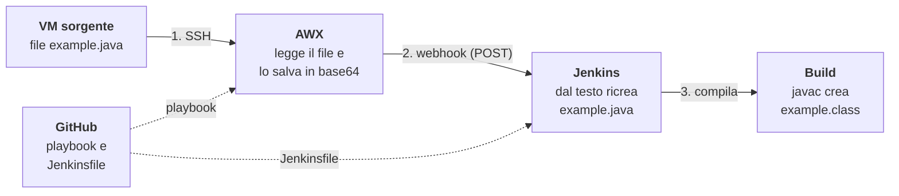

# Esercizio AWX - Jenkins

AWX legge un file Java da una VM e lo passa a Jenkins con un webhook. Jenkins lo ricrea, lo archivia come artefatto e lo compila con `javac`.
Il Jenkinsfile della pipeline viene scaricato da GitHub.

## La traccia
- Creare un Job template AWX che preleva da una VM un dato a piacere (ad esempio un sorgente Java "example.java")

- Creare un Webhook su AWX che si interfaccia a Jenkins creando un artefatto contenente il dato appena prelevato

- Triggerare da AWX una pipeline Jenkins che utilizzi l'artefatto per una build (es. javac example.java).

- Il Jenkinsfile della pipeline deve essere pullato da un Gitlab/Github

## Schema



## Funzionamento

1. **Lancio**: si avvia il Job Template `job-awx`. AWX prende il playbook dal Project, cioè dalla repo GitHub.
2. **Prelievo**: il playbook entra in SSH nella VM sorgente e legge `example.java` con `slurp`, che restituisce il contenuto già codificato in base64.
3. **Salvataggio**: `set_stats` salva il base64 negli *artifacts* del job (`java_b64`). Il container in cui gira il playbook viene distrutto a fine job, gli artifacts invece restano salvati in AWX.
4. **Webhook**: se il job finisce bene, AWX invia a Jenkins una POST.
5. **Avvio della pipeline**: il plugin Generic Webhook Trigger riconosce il job dal `token` nell'URL, copia `java_b64` nella variabile `JAVA_B64` e avvia `awx-java-build`. Jenkins scarica il Jenkinsfile da GitHub.
6. **Artefatto**: lo stage `Crea artefatto` decodifica il base64, ricrea `example.java` e lo archivia.
7. **Build**: lo stage `Build` compila con `javac`, esegue il programma, che stampa il messaggio, e archivia il file `.class`.

## Configurazione AWX

AWX è installato con l'AWX Operator 2.19.1 su Minikube.

| Oggetto | Nome | Impostazioni |
|---|---|---|
| Project | `awx-jenkins` | Git, repo `formazione_sou_k8s`, branch `main` |
| Inventory | `awx` | host della VM sorgente |
| Credential | `awx` | tipo Machine: utente `vagrant` + chiave SSH privata dedicata ad AWX |
| Job Template | `job-awx` | inventory `awx`, project `awx-jenkins`, playbook `awx-jenkins/preleva_java.yml`, credential `awx` |
| Notification | `webhook` | tipo Webhook, POST su `http://192.168.56.20:8080/generic-webhook-trigger/invoke?token=awx-java-build` |

Corpo della notifica (*Customize messages → Success message body*):

```json
{
  "awx_job_id": "{{ job.id }}",
  "java_b64": "{{ job.artifacts.java_b64 | default('') }}"
}
```

Il `| default('')` serve per poter salvare. Al salvataggio AWX controlla il template usando un job finto senza artifacts: senza il default, il campo `java_b64` non esiste e AWX rifiuta il salvataggio.

Infine la notifica va collegata al Job Template: *Job Template → Notifications →* toggle **Success**.

## Configurazione Jenkins

1. Installare il plugin **Generic Webhook Trigger**.
2. Creare il job `awx-java-build` di tipo Pipeline → *Pipeline script from SCM*: repo `formazione_sou_k8s`, branch `main`, Script Path `awx-jenkins/Jenkinsfile`.
3. Lanciare una prima build a mano. Fallisce con "Nessun dato da AWX", ma serve a registrare il trigger scritto nel Jenkinsfile.

## Limiti noti

- Il token del webhook è scritto in chiaro nel Jenkinsfile, quindi chi legge la repo può avviare la pipeline. Si può spostare in una credenziale Jenkins con `tokenCredentialId`.