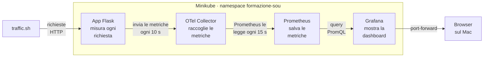

# Observability dell'app Flask

L'app Flask viene misurata con OpenTelemetry senza modificare il codice. Le metriche passano da un OpenTelemetry Collector a Prometheus e vengono mostrate in una dashboard Grafana. Tutto si installa con il chart Helm `charts/flask-app-example`.

## Schema di funzionamento



Le frecce seguono il percorso dei dati da sinistra a destra; sopra ogni freccia c'è cosa passa e ogni quanto.

Le sezioni da 1 a 10 seguono i punti richiesti dalla traccia.

**File principali**

- `step2-pipeline/`: l'app Flask e il suo `Dockerfile`
- `charts/flask-app-example/`: il chart con app, Collector, Prometheus e Grafana
- `charts/flask-app-example/dashboards/flask-dashboard.json`: la dashboard
- `observability/traffic.sh`: lo script che genera traffico
- `observability/manual/`: la prima versione fatta a mano, tenuta come riferimento

## 1. Avvio dell'ambiente

Kubernetes gira con Minikube dentro una VM Vagrant Ubuntu con IP `192.168.56.21`. Nella stessa VM ci sono anche Helm e kubectl.

```bash
vagrant up && vagrant ssh     # dal Mac, nella cartella del Vagrantfile
minikube start                # nella VM
kubectl get nodes             # il nodo deve essere Ready
```

L'immagine dell'app, `mattiaangelone/flask-app-example:v1.1.0`, è già su DockerHub: l'ha buildata Jenkins.

## 2. Installazione del chart

```bash
helm repo add prometheus-community https://prometheus-community.github.io/helm-charts
helm repo add grafana-community https://grafana-community.github.io/helm-charts
cd ~/formazione_sou_k8s/charts/flask-app-example
helm dependency build
helm upgrade --install flask-app-example . -n formazione-sou --set image.tag=v1.1.0
```

Partono quattro pod: l'app, il Collector, Prometheus e Grafana. L'app e il Collector sono template del chart; Prometheus e Grafana arrivano come sottochart dai repository della community.

L'observability si configura dal `values.yaml` (estratto):

```yaml
observability:
  enabled: true                                 # interruttore generale
otel:
  enabled: true
  serviceName: flask-app                        # nome del servizio nelle metriche
  exporterEndpoint: http://otel-collector:4317  # dove l'app manda le metriche
prometheus:
  enabled: true
grafana:
  enabled: true
```

## 3. Accesso a Prometheus

```bash
kubectl port-forward -n formazione-sou svc/flask-app-example-prometheus-server 9090:80 --address 0.0.0.0
```

Dal Mac apri `http://192.168.56.21:9090`. In **Status → Target health** il target `otel-collector` deve essere UP.

## 4. Accesso a Grafana

```bash
kubectl port-forward -n formazione-sou svc/flask-app-example-grafana 3000:80 --address 0.0.0.0
```

Dal Mac apri `http://192.168.56.21:3000` con l'utente `admin`. La password si legge così:

```bash
kubectl get secret -n formazione-sou flask-app-example-grafana -o jsonpath='{.data.admin-password}' | base64 -d; echo
```

La dashboard **Flask App** e la connessione a Prometheus sono già configurate dal chart.

Per tenere aperti tutti e due i port-forward in background c'è uno script: `nohup ./observability/port-forward.sh > /tmp/port-forward.log 2>&1 &`.

## 5. Verificare che OpenTelemetry sia attivo

1. Controlla che l'app abbia le variabili di OpenTelemetry:

    ```bash
    kubectl exec -n formazione-sou deploy/flask-app-example -- env | grep OTEL
    ```

2. In Prometheus, la query `up{job="otel-collector"}` deve restituire `1`: vuol dire che Prometheus legge il Collector.
3. La query `count by (__name__) ({__name__=~"http_server.*"})` deve elencare le metriche HTTP.

Le metriche compaiono solo dopo la prima richiesta all'app.

## 6. Generare traffico

```bash
./observability/traffic.sh     # senza argomenti usa l'URL del Service dell'app
```

Lo script manda sempre le stesse richieste:

| Quante | Richiesta | Risposta |
| --- | --- | --- |
| 100 | `GET /` | 200 |
| 50 | `GET /api/` | 200 |
| 20 | `GET /appi/` | 404 |
| 10 | `POST /` | 405 |

Dopo circa 30 secondi i pannelli di Grafana mostrano il traffico per endpoint, gli errori 4xx e la latenza. Per un confronto esatto, esegui in Prometheus questa query prima e dopo lo script:

```promql
sum by (http_route, http_response_status_code) (http_server_request_duration_seconds_count)
```

I valori devono crescere di 100, 50, 20 e 10.

**Scaling a 3 repliche**

```bash
kubectl scale deployment flask-app-example -n formazione-sou --replicas=3
./observability/traffic.sh
```

Nel pannello Requests per pod compaiono tre linee, una per pod. Lo scaling dura fino al prossimo `helm upgrade`.

## 7. Metriche disponibili

La metrica principale è `http_server_request_duration_seconds`, la durata delle richieste HTTP. È un istogramma, e in Prometheus diventa tre serie:

| Serie | Cosa contiene | A cosa serve |
| --- | --- | --- |
| `..._count` | il numero di richieste | richieste al secondo, errori, endpoint, pod |
| `..._bucket` | le richieste divise per fasce di durata | percentili della latenza |
| `..._sum` | la somma delle durate | latenza media |

Ogni serie ha queste etichette:

- `http_route`: l'endpoint (`/`, `/api/`); è vuota per le URL inesistenti
- `http_request_method`: il metodo (`GET`, `POST`)
- `http_response_status_code`: il codice di risposta (`200`, `404`, `405`)
- `k8s_pod_name`: il pod che ha risposto

Esiste anche `http_server_active_requests`, il numero di richieste in corso, che la dashboard non usa.

## 8. Query PromQL utilizzate

```promql
# Request rate per endpoint
label_replace(sum by (http_route) (rate(http_server_request_duration_seconds_count[$__rate_interval])), "http_route", "unmatched", "http_route", "")

# HTTP errors: 4xx e 5xx
sum(rate(http_server_request_duration_seconds_count{http_response_status_code=~"4.."}[$__rate_interval]))
sum(rate(http_server_request_duration_seconds_count{http_response_status_code=~"5.."}[$__rate_interval]))

# Request latency: 0.95 è il p95; per p50 e p99 si usa 0.50 e 0.99
histogram_quantile(0.95, sum by (le) (rate(http_server_request_duration_seconds_bucket[$__rate_interval])))

# Requests by endpoint: totale nell'intervallo scelto in Grafana
label_replace(sum by (http_route) (increase(http_server_request_duration_seconds_count[$__range])), "http_route", "unmatched", "http_route", "")

# Requests per pod
sum by (k8s_pod_name) (rate(http_server_request_duration_seconds_count{k8s_pod_name!=""}[$__rate_interval]))
```

Come leggerle:

- `rate()` calcola le richieste al secondo; `increase()` le richieste totali in un intervallo.
- `sum by (...)` somma le serie e ne tiene una per ogni valore dell'etichetta indicata.
- `histogram_quantile()` stima un percentile a partire dalle fasce di durata.
- `label_replace()` dà il nome `unmatched` alle richieste senza endpoint.
- `$__rate_interval` e `$__range` sono variabili di Grafana: nella UI di Prometheus vanno sostituite con una finestra fissa, per esempio `[1m]`.

## 9. Come funziona la pipeline delle metriche

1. **App**: il container parte con `opentelemetry-instrument python app.py`. OpenTelemetry si aggancia a Flask e misura ogni richiesta.
2. **Configurazione**: le variabili `OTEL_*` non stanno nell'immagine, le imposta il chart nel Deployment. Tra queste c'è il nome del pod, preso con la Downward API, che serve a distinguere le repliche.
3. **Collector**: l'app gli manda le metriche ogni 10 secondi, con il protocollo OTLP sulla porta 4317. Il Collector le rende leggibili da Prometheus sulla porta 8889.
4. **Prometheus**: ogni 15 secondi legge le metriche dal Collector e le salva.
5. **Grafana**: interroga Prometheus con PromQL. La connessione a Prometheus e la dashboard sono definite nel chart e caricate all'avvio.

Le probe dell'app sono di tipo TCP: controllano solo che la porta sia aperta. In questo modo Kubernetes non manda richieste HTTP che finirebbero nelle metriche.

## 10. Compromessi e limitazioni

- **Niente errori 5xx**: l'app non ha endpoint che falliscono, quindi la linea dei 5xx resta vuota.
- **Latenza poco significativa**: le richieste durano meno di 5 ms, quindi i percentili sono solo una stima dentro la prima fascia di durata.
- **Totali approssimati**: `increase()` stima i valori ai bordi dell'intervallo. Il pannello Requests by endpoint può mostrare circa il 5% in più, per esempio 105 invece di 100. I numeri esatti si leggono nei contatori, con la query della sezione 6.
- **Probe TCP**: controllano la porta, non che l'app risponda correttamente.
- **Un solo Collector**: se si ferma, l'app continua a funzionare, ma le metriche di quel periodo si perdono.

- **Accesso con port-forward**: il port-forward va rilanciato quando il pod cambia.
